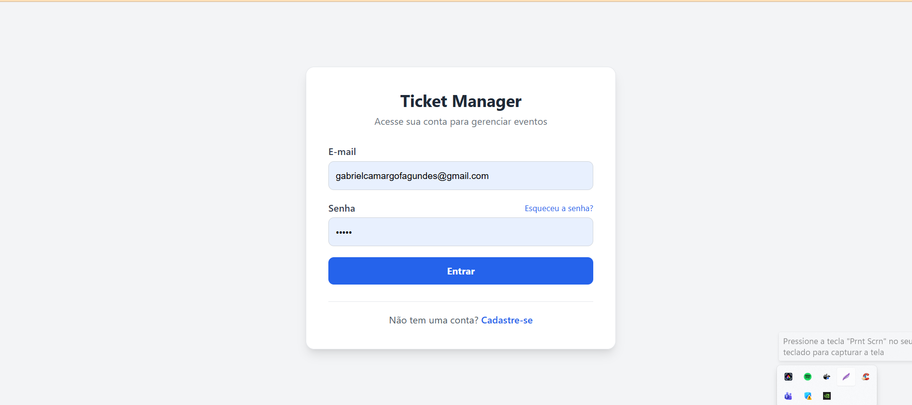
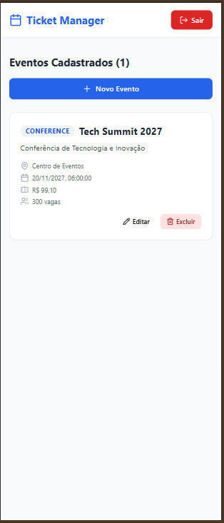

# Event Ticket Manager API

API REST desenvolvida em Node.js com Express e TypeScript para o gerenciamento de eventos e emissão de ingressos. Projeto desenvolvido como primeira etapa da disciplina.

---

##  Tecnologias Utilizadas

- **Linguagem:** Node.js, TypeScript
- **Framework Web:** Express
- **Banco de Dados:** MongoDB, Mongoose
- **Containerização:** Docker, Docker Compose
- **Documentação:** Swagger (swagger-ui-express, swagger-jsdoc)
- **Testes Automatizados:** Jest, Supertest, mongodb-memory-server

---

##  Como Configurar e Executar o Projeto

### Pré-requisitos
- Node.js (v18+)
- NPM
- Docker e Docker Compose (ou MongoDB instalado localmente)

### 1. Clonar o repositório e instalar dependências
```bash

## 📸 Capturas de Tela

### Tela de Login


### Painel de Eventos Cadastrados


### Cadastro de Novo Evento


### Edição de Evento


### Visualização Mobile (Responsividade)


npm install --legacy-peer-deps